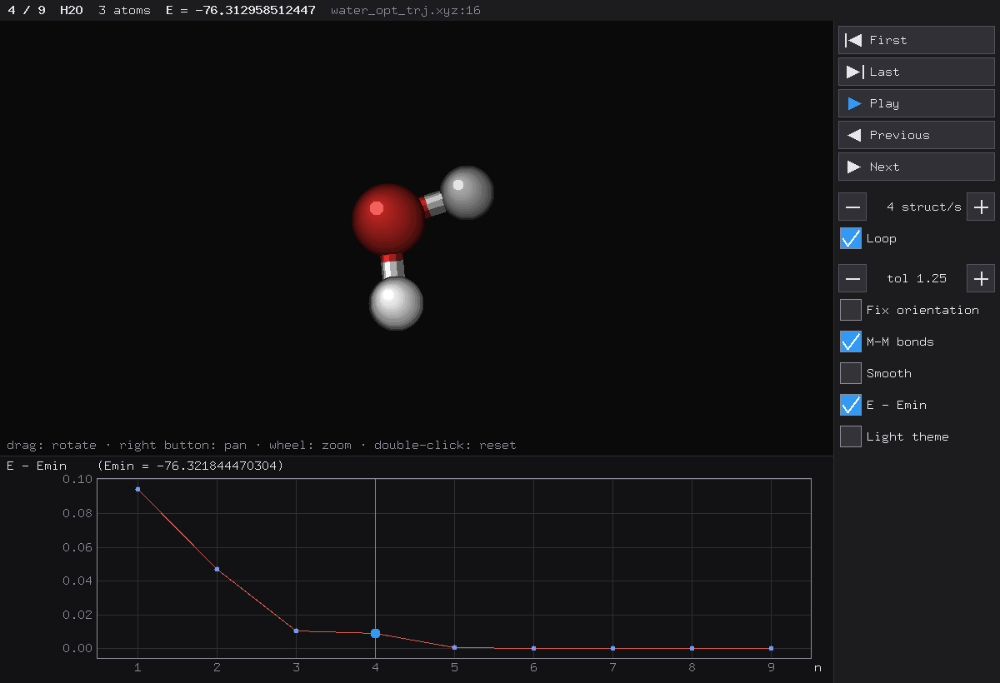

<p align="center">
  
</p>

<h1 align="center">MOLE</h1>

<p align="center">
  <b>Visor molecular ligero para archivos XYZ, Gaussian, ORCA y cube, con gráfica de energía E vs n.</b><br>
  Fluido por <code>ssh -Y</code> desde un clúster HPC · un único ejecutable · lee archivos XYZ, Gaussian, ORCA y cube
</p>

<p align="center">
  <a href="https://pypi.org/project/mole-viewer/"></a>
  <a href="https://github.com/Padalher/MOLE/actions/workflows/ci.yml"></a>
  <a href="LICENSE"></a>
  <a href="https://doi.org/10.5281/zenodo.23963301"></a>
</p>

<p align="center"><i><a href="README.md">English version</a></i></p>

<p align="center">
  
</p>

MOLE abre archivos XYZ con una o varias estructuras, salidas de Gaussian y de ORCA, y archivos cube. Se lanza desde la terminal y abre una ventana con:

- **la estructura en 3D**: bolas y barras; se gira, se mueve y se hace zoom con el ratón;
- **la gráfica de energía E vs n**: energías relativas (E − Emin) por defecto; al pasar el ratón sobre un punto se ven n, E y la etiqueta; clic o arrastrar recorre las estructuras;
- **una columna de controles junto a la estructura**, agrupados por lo que hacen (reproducción, enlaces, superficie, fuerzas, vista, gráfica): primera, última, reproducir/pausa, anterior, siguiente, velocidad, repetición, tolerancia de enlace, enlaces metal–metal, una orientación fija para todas las estructuras y un tema blanco; cada control es también una opción de la terminal (`mole --help`);
- **orbitales y densidades de archivos cube**: isosuperficies con el lóbulo positivo en rojo y el negativo en azul, un valor de iso ajustable y transparencia opcional.

MOLE está pensado para **correr en una máquina remota (un clúster HPC o una estación de trabajo) y verse por `ssh -Y`**. Dibuja con el protocolo X11 básico, así que por la red solo viajan órdenes de dibujo (unos KB por fotograma) y la ventana va fluida incluso con una conexión doméstica. Solo lee resultados; nunca ejecuta cálculos.

## Instalación
MOLE es un único ejecutable sin dependencias. No hacen falta permisos de administrador.

**Con pip** (Linux x86_64/aarch64, macOS, Windows):
```bash
pip install mole-viewer        # o: pip install --user mole-viewer · pipx install mole-viewer · uv tool install mole-viewer
mole                           # el paquete se llama mole-viewer; el comando es mole
```

Si no hay `pip` (algo común en los clústeres, donde no se pueden instalar paquetes del sistema), usa un entorno virtual, que trae su propio pip:
```bash
python3 -m venv ~/.local/mole-viewer
~/.local/mole-viewer/bin/pip install mole-viewer
mkdir -p ~/.local/bin && ln -sf ~/.local/mole-viewer/bin/mole ~/.local/bin/mole
```
(`~/.local/bin` debe estar en tu `PATH`; si no, añade `export PATH="$HOME/.local/bin:$PATH"` a `~/.bashrc`.)

**En Windows con WSL** (la terminal de Linux de Windows): abre la terminal de Linux e instala MOLE ahí con los comandos de Linux de arriba (`pip`, o el entorno virtual). En Windows 11, WSL ya trae servidor gráfico (WSLg), así que `mole archivo.xyz` abre la ventana directamente; en Windows 10 instala además [VcXsrv](https://github.com/marchaesen/vcxsrv) y define `DISPLAY`. Desde esa misma terminal también puedes conectarte a un clúster con `ssh -Y`.

**Binario precompilado** (Linux x86_64, estático; funciona con cualquier glibc):
```bash
curl -LO https://github.com/Padalher/MOLE/releases/latest/download/mole-x86_64-linux
chmod +x mole-x86_64-linux
mkdir -p ~/.local/bin && mv mole-x86_64-linux ~/.local/bin/mole
```

**Desde el código fuente** (requiere [Rust](https://rustup.rs)):
```bash
cargo install --git https://github.com/Padalher/MOLE mole
```

## Ver MOLE desde tu computadora
Instala MOLE donde están tus archivos (por ejemplo, el clúster) y conéctate con reenvío X11:
```bash
ssh -Y usuario@cluster
cd /ruta/a/resultados
mole estructuras.xyz
```

Tu computadora necesita un servidor X para mostrar la ventana:

| Tu computadora | Servidor X |
|---|---|
| Linux | incluido (X11 o Xwayland) |
| macOS | [XQuartz](https://www.xquartz.org) (cierra sesión y vuelve a entrar tras instalarlo) |
| Windows | [MobaXterm](https://mobaxterm.mobatek.net) (servidor X y cliente SSH en uno), o [VcXsrv](https://github.com/marchaesen/vcxsrv) con cualquier cliente SSH; con WSL en Windows 11 no hace falta (WSLg) |

Probado en Linux, en macOS (XQuartz) y en Windows a través de WSL (ver Instalación), tanto en local como viendo un clúster HPC por ssh. Windows nativo con VcXsrv (`set DISPLAY=localhost:0`) todavía no se ha probado.

## Uso
```bash
mole conjunto.xyz                 # XYZ con una o varias estructuras
mole calc_*.out                   # salidas de Gaussian u ORCA: una estructura por archivo
mole opt_trj.xyz                  # trayectoria de optimización de ORCA (E vs paso)
mole a.xyz b.xyz                  # varios archivos, en el orden dado
mole orbital.cube                 # archivo cube: átomos e isosuperficie
mole *.cub                        # varios cube, recorridos como estructuras
mole --smooth conjunto.xyz        # dibujo suavizado (XRender)
mole --light conjunto.xyz         # tema blanco
mole --frame 12 conjunto.xyz      # empezar en la estructura 12
mole --iso 0.05 orbital.cube      # valor de iso de la superficie
mole --list conjunto.xyz          # tabla de estructuras en la terminal, sin ventana
mole --help
```

- **Teclado:** ← → anterior/siguiente · espacio reproducir/pausa · Inicio/Fin primera/última · q o Esc salir.
- **Ratón (vista 3D):** arrastrar gira · botón derecho mueve · rueda acerca · doble clic restablece.
- **Ratón (gráfica):** al pasar sobre un punto se ven n, E y la etiqueta · clic o arrastrar recorre las estructuras · arrastrar su borde superior la hace más alta o más baja. Arrastrar el borde izquierdo de la columna de controles la ensancha.
- **Eje de energía:** relativo (E − Emin) por defecto; la casilla *E - Emin* lo cambia a energías absolutas.
- **Fix orientation:** gira todas las estructuras a la orientación de la que está en pantalla (átomo por átomo en trayectorias y confórmeros, por ejes principales en isómeros), para recorrer un conjunto sin que la vista salte.

La interfaz está en inglés.

**Pruébalo** con el ejemplo incluido en este repositorio: la optimización de geometría de una molécula de agua distorsionada (ORCA 6.1.1, B3LYP-D3BJ/def2-SVP; la entrada está en [`examples/water_opt.inp`](examples/water_opt.inp)):
```bash
mole examples/water_opt_trj.xyz
```

### Formatos y energías
| Archivo | Estructuras | Energía |
|---|---|---|
| `.xyz` | todas | de la línea de comentario de cada una: un número al inicio (`-3219847.92  etiqueta`), `E=-76.32`, `energy=-76.32` o `… E -76.32` (trayectorias `*_trj.xyz` de ORCA) |
| salida de Gaussian (`.out`, `.log`) | última geometría | última `SCF Done` |
| salida de ORCA (`.out`, `.log`) | última geometría | su `FINAL SINGLE POINT ENERGY` |
| cube de Gaussian (`.cube`, `.cub`) | átomos y una malla 3D (el primer conjunto de datos) | ninguna |

El programa que generó el archivo se reconoce por su contenido, no por la extensión. Las energías se muestran tal como se leen, sin convertir unidades. Por defecto la gráfica muestra energías relativas, E − Emin, en las mismas unidades, y escribe Emin encima; la casilla *E - Emin* la cambia a energías absolutas. La cabecera y el recuadro del puntero siempre muestran cada energía tal como se leyó. Las estructuras sin energía se pueden ver, pero no aparecen en la gráfica.

Probado con archivos XYZ y con salidas de Gaussian 16 Rev. B.01 y de ORCA 6.1.

Los XYZ extendidos (`Properties=species:S:1:pos:R:3:…` en la línea de comentario) conservan sus columnas numéricas extra por átomo: al pasar el puntero sobre un átomo se ven sus valores (cargas, funciones de Fukui, …), y una columna `forces:R:3` se dibuja como una flecha por átomo, escalada para que la fuerza mayor de cada estructura tenga siempre el mismo largo; la casilla *Arrows* las oculta. El `|F|` que aparece al pasar el puntero da la magnitud real.

Los archivos cube se probaron con orbitales, funciones de Fukui y densidades de Multiwfn y ORCA. Para que la ventana siga fluida por la red, una superficie se dibuja con 6000 caras como máximo (por encima se usa una malla más gruesa); la transparencia necesita XRender, así que activa el dibujo suavizado.

## Cómo citarlo
Si usas MOLE en un trabajo publicado, por favor cítalo con su DOI, [10.5281/zenodo.23963301](https://doi.org/10.5281/zenodo.23963301) (Zenodo; siempre apunta a la última versión, y cada versión tiene además su propio DOI ahí). Los datos están en [`CITATION.cff`](CITATION.cff), y el botón *Cite this repository* de GitHub los convierte a APA o BibTeX.

## Autores
- Pablo D. Alvarez-Hernandez: Universidad Juárez Autónoma de Tabasco, DACB – CICTAT, México. <pablo.alvarez@padalher.com>
- Filiberto Ortiz Chi: Cinvestav Unidad Mérida, TheoChem Mérida, México. <filiberto.ortiz@cinvestav.mx>

Dudas sobre el software: <contact@padalher.com>. Contacto académico: los correos de los autores, arriba.

MOLE fue diseñado, dirigido y validado por Pablo D. Alvarez-Hernandez. Se usaron asistentes de programación basados en IA para escribir y reestructurar partes del código, las pruebas automáticas y la documentación; cada cambio fue revisado y validado por el autor. Las energías y geometrías que muestra MOLE siempre se leen de los archivos de salida de los cálculos de química cuántica; nunca las genera un modelo de lenguaje.

## Licencia
[MIT](LICENSE).
