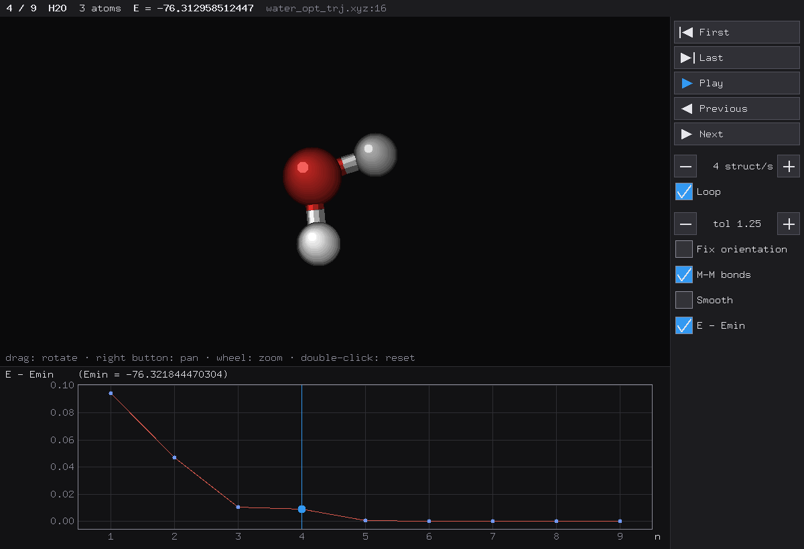

<p align="center">
  
</p>

<h1 align="center">MOLE</h1>

<p align="center">
  <b>A lightweight viewer for ensembles of molecular structures, with an E vs n energy plot.</b><br>
  Fluid over <code>ssh -Y</code> from an HPC cluster · a single executable · reads XYZ, Gaussian and ORCA files
</p>

<p align="center">
  <a href="https://pypi.org/project/mole-viewer/"></a>
  <a href="https://github.com/Padalher/MOLE/actions/workflows/ci.yml"></a>
  <a href="https://github.com/Padalher/MOLE/blob/main/LICENSE"></a>
</p>

<p align="center"><i><a href="https://github.com/Padalher/MOLE/blob/main/README.es.md">Versión en español</a></i></p>

<p align="center">
  
</p>

MOLE is made for conformer searches, global optimization runs and geometry optimization trajectories. Launched from the terminal, it opens a window with:

- **the 3D structure**: ball and stick; rotate, move and zoom with the mouse;
- **the energy plot E vs n**: relative energies (E − Emin) by default; hover a point to see n, E and the label; click or drag to browse the structures;
- **a column of controls next to the structure**: first, last, play/pause, previous, next, speed, loop, bond tolerance, metal–metal bonds and a fixed orientation for all the structures.

MOLE is designed to run **on a remote machine (an HPC cluster or a workstation) and be viewed over `ssh -Y`**. It draws with the core X11 protocol, so only drawing commands travel over the network (a few KB per frame), and the window stays fluid even on a home connection. It only reads results; it never runs calculations.

## Installation
MOLE is a single executable with no runtime dependencies. No administrator rights are needed.

**With pip** (Linux x86_64/aarch64, macOS, Windows):
```bash
pip install mole-viewer        # or: pip install --user mole-viewer · pipx install mole-viewer · uv tool install mole-viewer
mole                           # the package is called mole-viewer; the command is mole
```

If `pip` is not available (common on clusters, where you cannot install system packages), use a virtual environment, which brings its own pip:
```bash
python3 -m venv ~/.local/mole-viewer
~/.local/mole-viewer/bin/pip install mole-viewer
mkdir -p ~/.local/bin && ln -sf ~/.local/mole-viewer/bin/mole ~/.local/bin/mole
```
(`~/.local/bin` must be on your `PATH`; otherwise add `export PATH="$HOME/.local/bin:$PATH"` to `~/.bashrc`.)

**Prebuilt binary** (Linux x86_64, static; works with any glibc):
```bash
curl -LO https://github.com/Padalher/MOLE/releases/latest/download/mole-x86_64-linux
chmod +x mole-x86_64-linux
mkdir -p ~/.local/bin && mv mole-x86_64-linux ~/.local/bin/mole
```

**From source** (requires [Rust](https://rustup.rs)):
```bash
cargo install --git https://github.com/Padalher/MOLE mole
```

## Viewing MOLE from your computer
Install MOLE where your files are (e.g., the cluster) and connect with X11 forwarding:
```bash
ssh -Y user@cluster
cd /path/to/results
mole structures.xyz
```

Your computer needs an X server to display the window:

| Your computer | X server |
|---|---|
| Linux | built in (X11 or Xwayland) |
| macOS | [XQuartz](https://www.xquartz.org) (log out and back in after installing it) |
| Windows | [MobaXterm](https://mobaxterm.mobatek.net) (X server and SSH client in one), or [VcXsrv](https://github.com/marchaesen/vcxsrv) with any SSH client |

MOLE also runs locally on Linux. On macOS and Windows, it runs locally through XQuartz or VcXsrv (`set DISPLAY=localhost:0` on Windows), although this has not been tested yet.

## Usage
```bash
mole ensemble.xyz                 # XYZ file with one or more structures
mole calc_*.out                   # Gaussian or ORCA outputs: one structure per file
mole opt_trj.xyz                  # ORCA optimization trajectory (E vs step)
mole a.xyz b.xyz                  # several files, in the given order
mole --smooth ensemble.xyz        # antialiased drawing (XRender)
mole --list ensemble.xyz          # print the structure table, no window
mole --help
```

- **Keyboard:** ← → previous/next · space play/pause · Home/End first/last · q or Esc quit.
- **Mouse (3D view):** drag to rotate · right button to move · wheel to zoom · double click to reset.
- **Mouse (plot):** hover a point to see n, E and the label · click or drag to browse the structures · drag its top edge to make it taller or shorter.
- **Energy axis:** relative (E − Emin) by default; the *E - Emin* checkbox switches to absolute energies.
- **Fix orientation:** turns every structure to the orientation of the one on screen (atom by atom for trajectories and conformers, by principal axes for isomers), so an ensemble can be browsed without the view jumping.

**Try it** with the example included in this repository: the geometry optimization of a distorted water molecule (ORCA 6.1.1, B3LYP-D3BJ/def2-SVP, input in [`examples/water_opt.inp`](https://github.com/Padalher/MOLE/blob/main/examples/water_opt.inp)):
```bash
mole examples/water_opt_trj.xyz
```

### Formats and energies
| File | Structures | Energy |
|---|---|---|
| `.xyz` | all frames | from each comment line: a leading number (`-3219847.92  label`), `E=-76.32`, `energy=-76.32` or `… E -76.32` (ORCA `*_trj.xyz`) |
| Gaussian output (`.out`, `.log`) | last geometry | last `SCF Done` |
| ORCA output (`.out`, `.log`) | last geometry | its `FINAL SINGLE POINT ENERGY` |

The program is recognized by the file contents, not by the extension. Energies are shown as read, without unit conversion. By default the plot shows relative energies, E − Emin, in the same units, and writes Emin above it; the *E - Emin* checkbox switches it to absolute energies. The header and the tooltip always show each energy as read. Structures without an energy can be viewed, but they are not plotted.

Tested with XYZ files, Gaussian 16 Rev. B.01 and ORCA 6.1 outputs.

## Citation
If you use MOLE in published work, please cite it. The metadata are in [`CITATION.cff`](https://github.com/Padalher/MOLE/blob/main/CITATION.cff), and GitHub's *Cite this repository* button turns them into APA or BibTeX.

## Authors
- Pablo D. Alvarez-Hernandez: Universidad Juárez Autónoma de Tabasco, DACB – CICTAT, Mexico.
- Filiberto Ortiz Chi: Cinvestav Unidad Mérida, TheoChem Mérida, Mexico.

MOLE was designed, directed and validated by Pablo D. Alvarez-Hernandez. AI-based coding assistants were used to write and refactor parts of the code, the automated tests and the documentation; every change was reviewed and validated by the author. The energies and geometries that MOLE shows are always read from the quantum-chemistry output files, never generated by a language model.

## License
[MIT](https://github.com/Padalher/MOLE/blob/main/LICENSE).

## Development
```bash
cargo test                                   # tests
cargo clippy --all-targets && cargo deny check
MOLE_SAMPLES=/path/to/files cargo test       # also read your own files
MOLE_BENCH=200 mole file.xyz                 # play 200 frames, print the frame rate and exit
```

`mole-core` reads the files and has no graphics dependencies; `mole` is the window (X11 via [x11rb](https://github.com/psychon/x11rb)). Releases are built and published by GitHub Actions when a `v*` tag is pushed.
