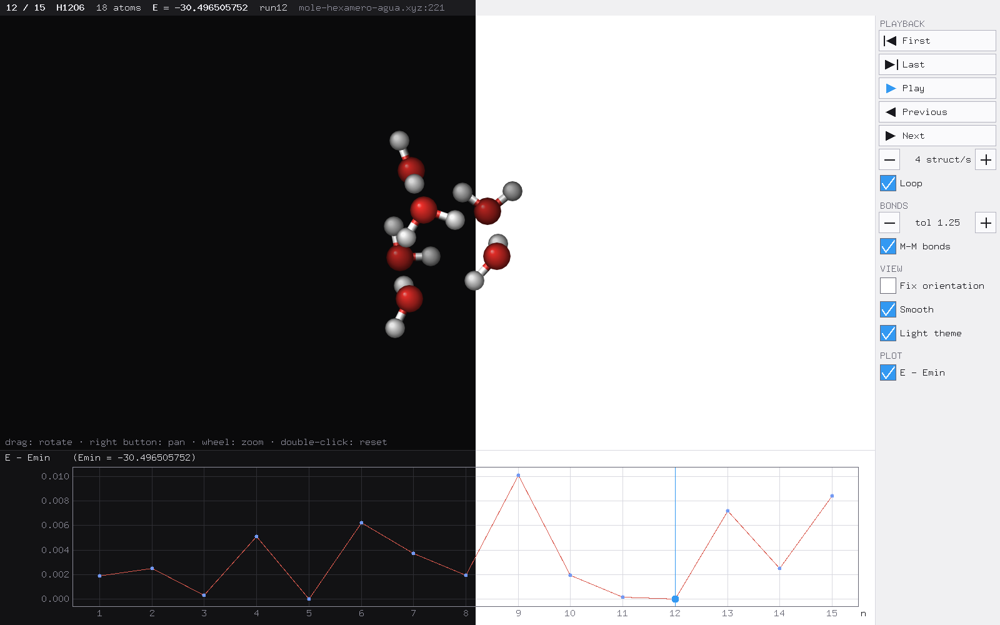

<p align="center">
  
</p>

<h1 align="center">MOLE</h1>

<p align="center">
  <b>A lightweight molecular viewer for XYZ, Gaussian, ORCA and cube files, with an E vs n energy plot.</b><br>
  Runs where your results are and is viewed over <code>ssh -Y</code> · a single executable under 1 MB · no dependencies
</p>

<p align="center">
  <a href="https://pypi.org/project/mole-viewer/"></a>
  <a href="https://github.com/Padalher/MOLE/actions/workflows/ci.yml"></a>
  <a href="https://github.com/Padalher/MOLE/blob/main/LICENSE"></a>
  <a href="https://doi.org/10.5281/zenodo.23963301"></a>
</p>

<p align="center"><i><a href="https://github.com/Padalher/MOLE/blob/main/README.es.md">Versión en español</a></i></p>

<p align="center">
  
</p>

MOLE opens XYZ files with one or more structures, Gaussian and ORCA output files and cube files. Launched from the terminal, it opens a window with:

- **the 3D structure**: ball and stick; rotate, move and zoom with the mouse;
- **the energy plot E vs n**: relative energies (E − Emin) by default; hover a point to see n, E and the label; click or drag to browse the structures;
- **a column of controls next to the structure**, grouped by what they do (playback, bonds, surface, forces, view, plot): first, last, play/pause, previous, next, speed, loop, bond tolerance, metal–metal bonds, a fixed orientation for all the structures and a white theme; the display options are also command-line options (`mole --help`);
- **orbitals and densities from cube files**: isosurfaces with the positive lobe in red and the negative one in blue, an adjustable isovalue and optional transparency;
- **values per atom and force arrows** from extended XYZ files (see *Formats and energies*).

MOLE is designed to run **on a remote machine (an HPC cluster or a workstation) and be viewed over `ssh -Y`**. It draws with the core X11 protocol, so only drawing requests travel over the network, never images. Measured traffic per frame: about 5 KB for a water molecule, 10 KB for a water hexamer and 74 KB for 100 atoms (25 KB with `--smooth`); the cube surfaces we tested added 28–120 KB. (MOLE 0.3.1, Linux with Xwayland, 1200 × 820 window; bytes sent to the X server counted with `strace` during `MOLE_BENCH=300 mole file`.) It only reads results; it never runs calculations.

## Installation
MOLE is a single executable with no runtime dependencies. No administrator rights are needed.

**With pip** (Linux x86_64/aarch64, macOS; on Windows, use WSL as described below):
```bash
pip install mole-viewer        # or: pip install --user mole-viewer · pipx install mole-viewer · uv tool install mole-viewer
mole                           # the package is called mole-viewer; the command is mole
```

If `pip` is not available (common on clusters, where you cannot install system packages), use a virtual environment, which brings its own pip:
```bash
python3 -m venv ~/.local/mole-viewer
~/.local/mole-viewer/bin/pip install mole-viewer
mkdir -p ~/.local/bin && ln -sf ~/.local/mole-viewer/bin/mole ~/.local/bin/mole
```
(`~/.local/bin` must be on your `PATH`; otherwise add `export PATH="$HOME/.local/bin:$PATH"` to `~/.bashrc`.)

**On Windows with WSL** (the Linux terminal of Windows): open the Linux terminal and install MOLE there with the Linux commands above (`pip`, or the virtual environment). On Windows 11, WSL already includes a display server (WSLg), so `mole file.xyz` opens the window directly; on Windows 10, also install [VcXsrv](https://github.com/marchaesen/vcxsrv) and set `DISPLAY`. From the same terminal you can also connect to a cluster with `ssh -Y`.

**Prebuilt binary** (Linux x86_64, static; works with any glibc):
```bash
curl -LO https://github.com/Padalher/MOLE/releases/latest/download/mole-x86_64-linux
chmod +x mole-x86_64-linux
mkdir -p ~/.local/bin && mv mole-x86_64-linux ~/.local/bin/mole
```

**From source** (requires [Rust](https://rustup.rs)):
```bash
cargo install --git https://github.com/Padalher/MOLE mole
```

## Viewing MOLE from your computer
Install MOLE where your files are (e.g., the cluster) and connect with X11 forwarding:
```bash
ssh -Y user@cluster
cd /path/to/results
mole structures.xyz
```

Your computer needs an X server to display the window:

| Your computer | X server |
|---|---|
| Linux | built in (X11 or Xwayland) |
| macOS | [XQuartz](https://www.xquartz.org) (log out and back in after installing it) |
| Windows | [MobaXterm](https://mobaxterm.mobatek.net) (X server and SSH client in one), or [VcXsrv](https://github.com/marchaesen/vcxsrv) with any SSH client; with WSL on Windows 11, none is needed (WSLg) |

Tested on Linux, on macOS (XQuartz) and on Windows through WSL (see Installation), both locally and viewing an HPC cluster over ssh. Native Windows with VcXsrv (`set DISPLAY=localhost:0`) has not been tested yet.

## Usage
```bash
mole ensemble.xyz                 # XYZ file with one or more structures
mole calc_*.out                   # Gaussian or ORCA outputs: every optimization step
mole opt_trj.xyz                  # ORCA optimization trajectory (E vs step)
mole a.xyz b.xyz                  # several files, in the given order
mole orbital.cube                 # cube file: atoms and an isosurface
mole *.cub                        # several cube files, browsed like structures
mole --smooth ensemble.xyz        # antialiased drawing (XRender)
mole --light ensemble.xyz         # white theme
mole --frame 12 ensemble.xyz      # start at structure 12
mole --iso 0.05 orbital.cube      # isovalue of the surface
mole --list ensemble.xyz          # print the structure table, no window
mole --help
```

- **Keyboard:** ← → previous/next · space play/pause · Home/End first/last · q or Esc quit.
- **Mouse (3D view):** drag to rotate · right button to move · wheel to zoom · double click to reset.
- **Mouse (plot):** hover a point to see n, E and the label · click or drag to browse the structures · drag its top edge to make it taller or shorter. Drag the left edge of the controls column to widen it.
- **Large structures:** bonds are drawn up to 10 000 atoms; larger structures show only the atoms.
- **Energy axis:** relative (E − Emin) by default; the *E - Emin* checkbox switches to absolute energies.
- **Fix orientation:** turns every structure to the orientation of the one on screen (atom by atom for trajectories and conformers, by principal axes for isomers), so an ensemble can be browsed without the view jumping.

The window's interface is in English.

**Try it** with the example included in this repository: the geometry optimization of a distorted water molecule (ORCA 6.1.1, B3LYP-D3BJ/def2-SVP, input in [`examples/water_opt.inp`](https://github.com/Padalher/MOLE/blob/main/examples/water_opt.inp)):
```bash
mole examples/water_opt_trj.xyz
```

### Formats and energies
| File | Structures | Energy |
|---|---|---|
| `.xyz` | all frames | from each comment line: a leading number (`-3219847.92  label`), `E=-76.32`, `energy=-76.32` or `… E -76.32` (ORCA `*_trj.xyz`) |
| Gaussian output (`.out`, `.log`) | every geometry with an `SCF Done` (all the steps of an optimization or scan; a repeated calculation at the same geometry, e.g. a frequency job, is not repeated) | its `SCF Done` |
| ORCA output (`.out`, `.log`) | every geometry with a `FINAL SINGLE POINT ENERGY` (all the optimization cycles and the final evaluation) | its `FINAL SINGLE POINT ENERGY` |
| Gaussian cube (`.cube`, `.cub`) | atoms and a 3D grid (first data set) | none |

The program is recognized by the file contents, not by the extension. Energies are shown as read, without unit conversion. By default the plot shows relative energies, E − Emin, in the same units, and writes Emin above it; the *E - Emin* checkbox switches it to absolute energies. The header and the tooltip always show each energy as read. Structures without an energy can be viewed, but they are not plotted.

Tested with XYZ files, Gaussian 16 Rev. B.01 and ORCA 6.1 outputs.

Extended XYZ files (`Properties=species:S:1:pos:R:3:…` in the comment line) keep their extra numeric columns per atom: hovering over an atom shows its values (charges, Fukui functions, …), and a `forces:R:3` column is drawn as one arrow per atom, starting at the atom surface. The arrow length grows with the logarithm of the force, with one scale for the whole file: the largest force sticks out 1 Å, and forces well below 0.01 eV/Å give no visible arrow, so forces over several orders of magnitude can be compared. Forces are taken in eV/Å (the extended XYZ convention), or in Hartree/bohr when the comment line has `forces_unit=Ha/bohr`. The *Arrows* checkbox hides them; the `|F|` shown when hovering is the value in the file. The structure name is read from `label=`, `name=` or `i=`.

Cube files were tested with orbitals, Fukui functions and densities from Multiwfn and ORCA. To keep the traffic low, a coarser grid is used when a surface would have more than 6000 faces, which keeps it near that number; transparency needs XRender, so it turns on smooth drawing.

## Citation
If you use MOLE in published work, please cite it with its DOI, [10.5281/zenodo.23963301](https://doi.org/10.5281/zenodo.23963301) (Zenodo; it always points to the latest version, and each version also has its own DOI there). The metadata are in [`CITATION.cff`](https://github.com/Padalher/MOLE/blob/main/CITATION.cff), and GitHub's *Cite this repository* button turns them into APA or BibTeX.

## Authors
- Pablo Daniel Álvarez Hernández: DACB-UJAT. <pablo.alvarez@padalher.com>
- Filiberto Ortiz Chi: SECIHTI-Cinvestav Unidad Mérida. <filiberto.ortiz@cinvestav.mx>

Questions about the software: <contact@padalher.com>. Academic contact: the authors' addresses above.

MOLE was designed, directed and validated by Pablo Daniel Álvarez Hernández. AI-based coding assistants were used to write and refactor parts of the code, the automated tests and the documentation; every change was reviewed and validated by the author. The energies and geometries that MOLE shows are always read from the quantum-chemistry output files, never generated by a language model.

## License
[MIT](https://github.com/Padalher/MOLE/blob/main/LICENSE). Element colors that MOLE does not set itself come from the [Blue Obelisk Data Repository](https://github.com/BlueObelisk/bodr) (MIT license).

## Development
```bash
cargo test                                   # tests
cargo clippy --all-targets && cargo deny check
MOLE_SAMPLES=/path/to/files cargo test       # also read your own files
MOLE_BENCH=200 mole file.xyz                 # play 200 frames, print the frame rate and exit
```

`mole-core` reads the files and has no graphics dependencies; `mole` is the window (X11 via [x11rb](https://github.com/psychon/x11rb)). Releases are built and published by GitHub Actions when a `v*` tag is pushed.
